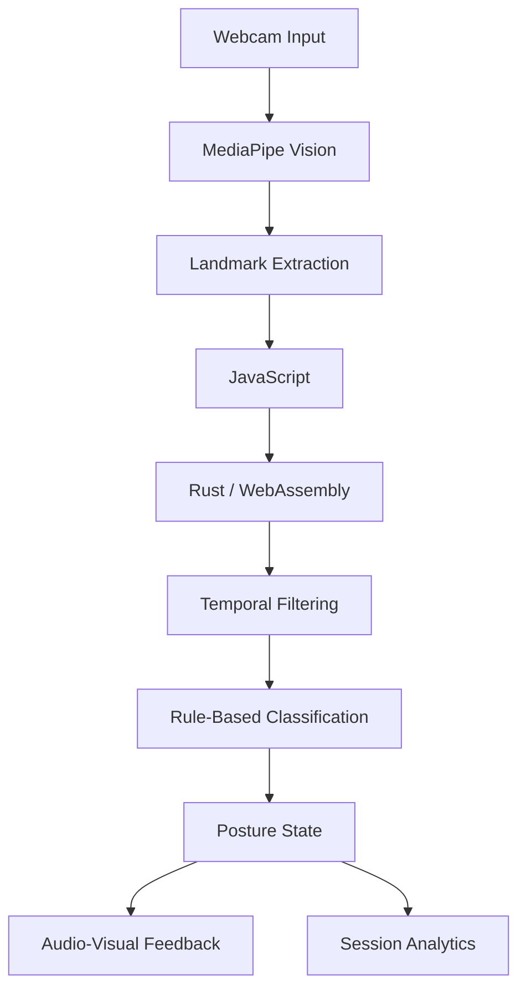

# 🧍 Summitra — Real-Time Posture Monitoring

<p align="center">
  <strong>Computer Vision • Rust • WebAssembly • Real-Time Analytics</strong>
</p>

<p align="center">
  
  
  
</p>

<p align="center">
  
  
  
  
  
  
</p>

---

## 📌 Overview

**Summitra** is a browser-based, real-time posture monitoring system that leverages computer vision to identify postural deviations during prolonged screen-based activities.

Using webcam-based pose estimation and a Rust-powered WebAssembly computational engine, Summitra evaluates posture measurements, applies temporal filtering, and generates corrective audio-visual feedback.

## ✨ Features

- 🎥 **Real-Time Pose Estimation** — Webcam-based landmark detection using MediaPipe.
- 📐 **Posture Classification** — Rule-based evaluation of posture measurements.
- ⚡ **Temporal Filtering** — Sliding-window averaging and variance analysis for stable classification.
- 🔔 **Corrective Feedback** — Audio-visual alerts triggered by posture-state transitions.
- 📊 **Session Analytics** — Tracks alert timestamps, deviation types, and measured angles.
- 🔒 **Browser-Based Processing** — Processes webcam frames locally within the browser.

## 🏗️ Architecture



## 🛠️ Technology Stack

| Layer | Technologies |
|---|---|
| Frontend | HTML5, CSS3, JavaScript |
| Computer Vision | MediaPipe Tasks Vision |
| Computation | Rust |
| Runtime | WebAssembly (WASM) |
| Data Processing | Sliding Window, Statistical Filtering |
| Feedback | JavaScript Audio API |

## ⚙️ Core Implementation

**1. Landmark Processing**

MediaPipe extracts body landmarks from webcam frames to support posture evaluation.

**2. Temporal Analysis**

A sliding-window buffer implemented using Rust's `VecDeque` maintains recent tilt measurements. Mean and variance calculations help assess alignment and stability.

**3. State Classification**

Threshold-based rules classify posture into Good and Bad states, with state-transition detection controlling corrective feedback.

**4. Session Monitoring**

The dashboard presents real-time feedback, measured tilt angles, and timestamped posture events.

## 🖥️ Application Preview

<p align="center">
  <i>Live posture monitoring dashboard</i>
</p>

<!-- Add your dashboard screenshot here -->
<!--  -->

## 🚀 Getting Started

### Prerequisites

- Modern browser with webcam support
- Rust toolchain
- `wasm-pack`
- Local development server

### Installation

```bash
git clone <YOUR_REPOSITORY_URL>
cd Summitra
```

Build the Rust/WASM module using the project's WebAssembly build configuration, then launch the frontend using a local development server.

Grant webcam permissions when prompted.

## 🔐 Privacy

Summitra is designed for browser-based video processing. Webcam footage is processed locally in the browser; no video upload is required by the supplied posture-processing implementation.

## 🔮 Future Scope

- Personalized posture calibration
- Expanded multi-landmark classification
- Adaptive corrective feedback
- Longitudinal posture analytics
- Enhanced deviation detection

---

<p align="center">
  <strong>Summitra</strong><br/>
  <i>Reaching the epitome of wellness.</i>
</p>
